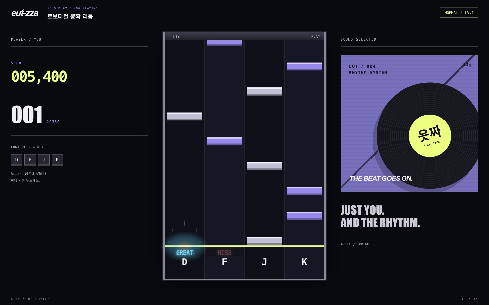
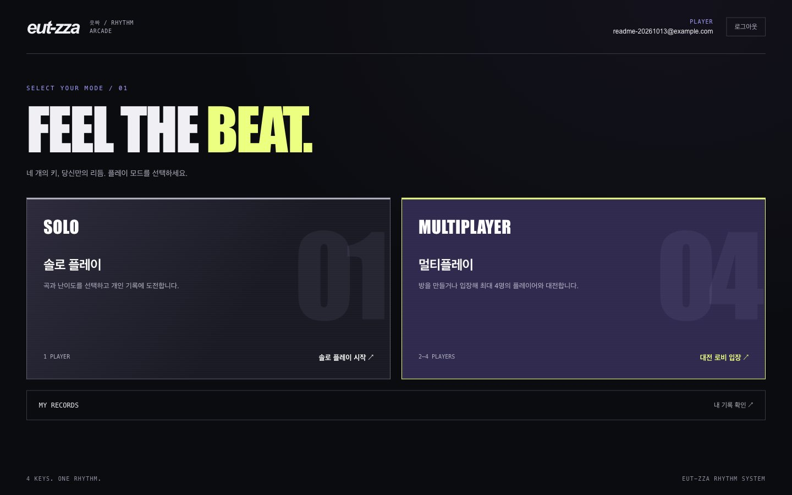
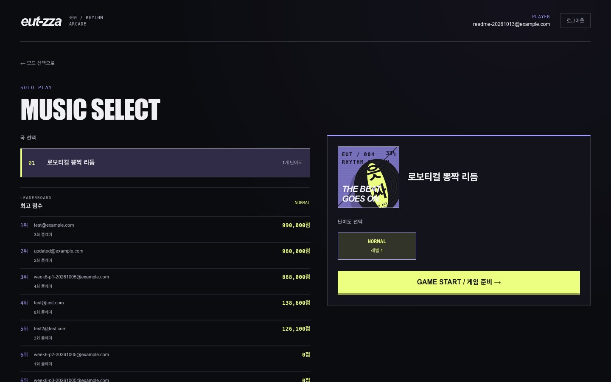

# eut-zza · 읏짜

> 네 개의 키, 당신만의 리듬. 4 KEYS. ONE RHYTHM.

**읏짜**는 브라우저에서 즐기는 4키 리듬게임입니다. 혼자 최고 기록에 도전하거나, 한 방에서 최대 4명이 같은 곡을 플레이하며 실시간으로 점수를 겨룰 수 있습니다.

90년대 후반부터 2000년대 초반 리듬 아케이드의 분위기를 바탕으로, 어두운 게임 화면과 선명한 판정 효과를 구성했습니다. 키보드를 사용하는 데스크톱 환경을 기준으로 개발하고 있습니다.



## 플레이 방법

1. 회원가입 후 로그인합니다.
2. **솔로 플레이** 또는 **멀티플레이**를 선택합니다.
3. 노트가 아래쪽 판정선에 닿는 순간, 해당 레인의 **D · F · J · K** 키를 누릅니다.
4. 입력 시점에 따라 **PERFECT / GREAT / GOOD / MISS**가 표시됩니다. 성공 판정에는 색이 다른 빛 효과가 나오며, 점수와 콤보가 갱신됩니다.

### 솔로 플레이

곡과 난이도를 선택하고 게임을 시작합니다. 플레이가 끝나면 결과를 저장하고, 개인 기록과 곡·난이도별 최고 점수 순위를 확인할 수 있습니다.

### 멀티플레이

- 방을 만들거나 기존 방에 입장해 **2~4명**이 함께 플레이합니다.
- 방을 만든 사람이 방장이며, **방장만 곡과 난이도를 선택**합니다.
- 모든 참가자의 준비가 완료되면 채보 변경이 잠기며, 음원 준비와 공통 시작 시각을 통해 함께 시작합니다.
- 플레이 중 상대방의 점수와 콤보를 실시간으로 확인합니다.
- 경기 결과를 확인한 뒤 방 대기화면으로 돌아가 다음 경기를 이어갑니다.
- 방장 퇴장 시 방장을 승계하며, 새로고침·일시적인 연결 끊김에는 재접속 유예를 적용합니다.

개별 경기 결과는 저장하지만, 별도의 승패 전적은 관리하지 않습니다.

## 화면 둘러보기

### 모드 선택



### 곡·난이도 선택



위 이미지는 로컬 개발 환경에서 촬영한 실제 화면입니다. 표시된 계정과 기록은 테스트 데이터입니다.

## 주요 구현

- **Canvas 게임 화면**: React와 분리된 TypeScript 게임 엔진이 노트 렌더링, 키 입력, 판정을 담당합니다.
- **오디오 기준 시간**: Web Audio의 재생 시간을 기준으로 노트 위치를 계산하고, `requestAnimationFrame`으로 화면을 갱신합니다.
- **실시간 대전**: WebSocket으로 방 상태와 점수·콤보를 공유하고, 시계 차이를 보정해 미래의 공통 시작 시각에 맞춥니다.
- **인증과 기록**: 쿠키 기반 세션 인증, PostgreSQL 경기 결과 저장, 개인 기록 조회를 제공합니다.
- **Redis 활용**: 리더보드 캐시와 자동 매칭에 사용합니다. 영구 경기 기록의 기준 데이터는 PostgreSQL입니다.

### 현재 설계와 범위

- 현재 음원은 FE의 `public/audio`에서 제공하며, 플레이에는 **180개 노트의 공통 샘플 채보**를 사용합니다. 곡마다 별도로 제작된 채보를 제공하는 단계는 아닙니다.
- 판정과 점수 계산은 클라이언트가 담당합니다. 서버는 클라이언트가 제출한 최종 경기 결과를 신뢰하는 설계이며, 서버 재판정이나 부정행위 방지를 보장하지 않습니다.
- 방 상태와 연결 정보는 Backend 프로세스 메모리에 있으므로 **Backend 단일 Replica**를 전제로 합니다. 서버 재시작 시 진행 중인 방은 복원되지 않습니다.

## 기술 구성

| 영역 | 기술 |
| --- | --- |
| Frontend | React, TypeScript, Vite, React Router, TanStack Query, CSS Modules |
| 게임 엔진 | Canvas 2D, Web Audio API, requestAnimationFrame |
| Backend | Node.js, Fastify, WebSocket, Argon2 |
| 데이터 | PostgreSQL, node-postgres, Redis |
| 배포 | Railway, Docker, Nginx |

React는 화면 이동과 UI를, 게임 엔진은 프레임 단위의 플레이를 담당합니다. WebSocket의 중간 점수 공유와 HTTP의 최종 결과 저장은 별도 책임으로 나눴습니다.

## 로컬 실행

### 준비

- Node.js **24 이상**과 npm
- 실행 중인 PostgreSQL 및 Redis — PostgreSQL 18 기반으로 개발했습니다.
- 로컬 PostgreSQL에 접근할 수 있는 사용자 계정

아래 명령은 저장소 루트에서 시작합니다. FE와 BE는 각각 의존성을 설치합니다.

### 1. Backend

```sh
cd eut-zza-BE
npm ci
cp .env.example .env
```

이미 `.env`가 있다면 덮어쓰지 말고 필요한 값만 확인합니다. `.env`의 `PGUSER`와 비밀번호 등은 **자신의 PostgreSQL 설정**에 맞게 변경합니다.

```dotenv
HOST=127.0.0.1
PORT=3001
FRONTEND_ORIGIN=http://localhost:5173
NODE_ENV=development
PGHOST=127.0.0.1
PGPORT=5432
PGDATABASE=eut_zza
PGUSER=your_postgres_user
# PGPASSWORD=your_local_password
REDIS_URL=redis://127.0.0.1:6379
```

접속 정보는 개별 `PG*` 변수 대신 `DATABASE_URL`로 설정할 수도 있습니다. 실제 비밀번호는 저장소에 커밋하지 않습니다.

처음 실행할 때 빈 데이터베이스를 만들고, 테이블과 기본 곡 데이터를 준비합니다. 데이터베이스가 이미 있다면 `createdb`는 생략합니다.

```sh
createdb -h 127.0.0.1 -U your_postgres_user eut_zza
npm run db:migrate
npm run db:seed
npm run dev:fastify
```

`db:seed`는 기본 곡·채보 메타데이터를 준비하며, 회원 계정은 생성하지 않습니다. `http://localhost:3001/health`에서 서버 상태를 확인할 수 있습니다.

> BE의 `npm run dev`는 학습용 raw HTTP 서버입니다. 게임용 서버는 반드시 `npm run dev:fastify`로 실행합니다.

### 2. Frontend

별도 터미널에서 실행합니다.

```sh
cd eut-zza-FE
npm ci
VITE_API_BASE_URL=http://localhost:3001 npm run dev
```

브라우저에서 **http://localhost:5173**에 접속해 회원가입합니다. 위 명령은 FE 환경변수 파일에 운영 API 주소가 있어도 로컬 Backend를 사용하도록 지정합니다.

로컬에서는 FE와 API 주소의 호스트 이름을 `localhost`로 맞춥니다. `localhost`와 `127.0.0.1`을 섞어 사용하면 쿠키의 SameSite 정책 때문에 로그인 후 인증 요청이 실패할 수 있습니다.

### 검사 명령

각 프로젝트 폴더에서 실행합니다.

```sh
# eut-zza-FE
npm run lint
npm run build

# eut-zza-BE
npm run lint
npm run typecheck
npm test
npm run build
```

## 저장소 구조

```text
eut-zza/
├── eut-zza-FE/
│   ├── src/
│   │   ├── game/          # React와 분리된 게임 엔진
│   │   ├── pages/         # URL별 화면
│   │   └── components/    # UI와 컴포넌트별 CSS Modules
│   ├── public/audio/     # 플레이 음원
│   └── docs/             # 프론트엔드·브라우저 학습 기록
├── eut-zza-BE/
│   ├── src/              # API, 인증, 방·게임 상태, DB 접근
│   ├── sql/              # 스키마 마이그레이션과 Seed
│   ├── test/             # Backend 테스트
│   └── docs/             # 백엔드·네트워크·DB 학습 기록
├── docs/images/          # README용 실제 화면 이미지
├── road-map.md           # 개발·학습 로드맵
└── AGENTS.md             # 에이전트 작업 지침
```

## 배포와 학습 기록

Railway에서 FE, BE, PostgreSQL, Redis를 분리해 운영합니다. FE는 빌드된 정적 파일을 Nginx로 제공하고, BE는 Node.js로 실행합니다. `VITE_*` 값은 FE **빌드 시점**에 반영되며, Backend의 DB 접속 정보 등은 **실행 환경변수**로 주입합니다.

이 프로젝트는 React 프론트엔드 개발 경험을 바탕으로 JavaScript 엔진, 브라우저 렌더링, 네트워크, 데이터베이스와 배포까지 직접 이해하기 위한 학습 프로젝트이기도 합니다.

- [개발·학습 로드맵](road-map.md)
- [Frontend 학습 기록](eut-zza-FE/docs)
- [Backend 주차별 학습 기록](eut-zza-BE/docs)
